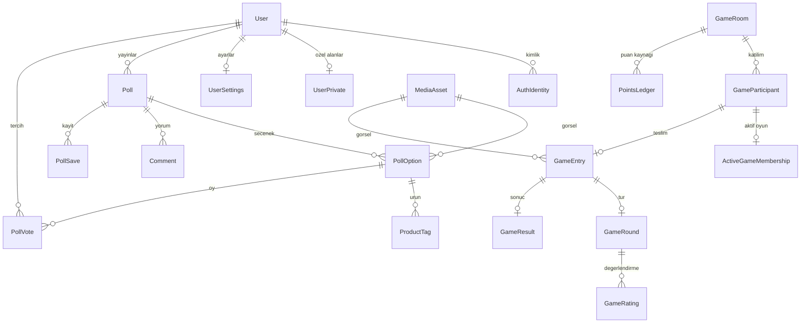

# Veri modeli ve bütünlük

Çalıştırılabilir kaynak: `prisma/schema.prisma`. İlk migration tabloları, ikinci migration Prisma DSL'de ifade edilmeyen CHECK kurallarını, üçüncü migration yerel proje sahiplik işaretini oluşturur. `db push` yerine migration kullanılmalıdır; aksi halde ek migration'lardaki kurallar eksik kalabilir.

## 1. İlişki haritası



Arkadaşlık ve engelleme User'a iki taraftan bağlanan ayrı ilişkilerdir. Oylamanın her seçeneği ayrı satırdır. Canlı oyunlar normal oylama tablosuna dönüştürülmez.

## 2. Şemada bulunan tablolar

| Alan | Modeller | Açıklama |
| --- | --- | --- |
| Kullanıcı | User, AuthIdentity, UserPrivate, UserSettings | Kamusal profil / dış kimlik / özel bilgiler / bildirim ve paylaşım varsayılanları ayrımı; `profileCompletedAt` ilk kurulum durumu |
| Giriş | AuthCredential, AuthSession, UsedRefreshToken, AuthActionToken | Özel parola hash'i/doğrulama, cihaz oturumu, refresh tekrar tespiti ve tek kullanımlık e-posta işlemleri |
| Tarz | StyleTag, UserStyle | Kontrollü stil sözlüğü ve çoklu seçim |
| Sosyal | Friendship, Block | Karşılıklı kabul edilmiş ilişki; yönlü engel |
| Fotoğraf | MediaAsset | Sahip, staging/display anahtarı, sürüm, durum, önizleme |
| Oylama | Poll, PollOption, ProductTag, PollVote | Ana paylaşım, 2–4 seçenek, ürün bağlantıları, tercih |
| Etkileşim | PollSave, Comment, PollVoteReason | Kaydetme, düz yorum ve oy sonrası neden |
| Hesap yaşam döngüsü | AccountDeletion | Tekil kapatma/temizlik işi; tamamlanınca geçici dosya eşleme bilgisi boşalır |
| Yönetim | Report, ModerationAudit | Şikâyet kararı/yaptırım denetimi; User.role ortak yetki |
| Bildirim | Notification, DeviceToken | Tekilleşmiş uygulama içi olay ve cihaz kaydı |
| Aktif oyun | GameSession, GameMembership, GameSubmission, GameScore, GameOutcome | Günlük 30+30 / QR lobisi, üyelik, fotoğraf, 1–5 yıldız ve ham sonuç |
| Eski oyun | Theme, GameRoom, GameParticipant, ActiveGameMembership | Eski taslak; aktif servis bu oda/tur modelini kullanmaz |
| Eski oyun içeriği | GameEntry, GameRound, GameRating, GameResult | Eski taslağın teslim/tur/sonucu; demo geçmişi korunur |
| Ödül | PointsLedger | Kaynağı belli puan hareketleri; ödül dağıtımı kapalı |
| Güvenilirlik | OutboxEvent, IdempotencyRecord | Transaction sonrası işler ve komut tekrarları |

Toplam 41 model vardır. Health, auth, users, social, yerel media/avatar, polls/tercih/sonuç/kapanış, akış/etkileşim, bildirim, günlük/QR oyun ve yönetim ilk teslimi çalışır. Auth oturum ve token hash'leri kamusal profil yanıtına girmez. Gerçek sağlayıcı ile mock kimlikler farklı issuer kullanır.

Altıncı migration UserSettings ve UserPrivate.analyticsRevision alanını ekler. Analiz izni/demografi değişikliği ve outbox olayı aynı transaction'a yazılır; ham demografik değerler olay gövdesinde yer almaz. Analiz/trend tüketimi henüz yoktur; bildirim/canlı bağlantı outbox işçisi çalışır. Özel alanlar, ayar varsayılanları ve sayaç görünürlüğü: [users rehberi](users-development.md).

Yedinci migration User.socialRevision ekler. İlişki/engel değişikliği, iki kullanıcının sosyal sürümü ve hedefli iç outbox olayları tek transaction'dadır. Bildirime dönüşüm olay kuyruğu işçisindedir ([bildirim rehberi](notifications-development.md)); engel olayının payload'u istemciye açılmaz. [Sosyal kurallar ve erişim servisi](social-development.md).

Sekizinci migration MediaPurpose (ilk aşamada POLL/AVATAR; 11. migration ile GAME), uploadTokenHash/son süre/beyan alanları, thumbnailKey, processingRevision/processingRequestHash/rejectionCode/filesPurgedAt ve User.avatarMediaId ilişkisini ekler. ByteSize beyanı 1–10 MiB, işlem sürümü negatif olamaz. FK avatar sahipliği/amacı/onayını tek başına doğrulamaz; bunlar kilit altında MediaService tarafından kontrol edilir. Kaynak/çıktı anahtarları kamusal yanıta girmez. [Medya yaşam döngüsü](media-development.md).

Dokuzuncu migration ProductTag.priceRecordedAt ekler. Fiyatın doğrulandığı/güncellendiği tarih değil, kullanıcı beyanının sunucuda kaydedildiği zamandır; eski kayıtlarda null kalır. ProductTag hâlâ seçenek sahibinin kullanıcı beyanıdır, ortak katalog değildir; productId henüz yoktur. Var olan IdempotencyRecord modeli 24 saatlik oylama makbuzları için kullanılmaya başladı. Onuncu migration PollVote.analyticsConsentAtVote/analyticsRevisionAtVote ve ikisinin birlikte bulunmasını denetleyen CHECK ekler. Oy izinsizse demografi/izin bağlamı null; izin geri alınırsa snapshot aynı transaction’da temizlenir. Eski oya izin uydurulmaz. [Tercih/sonuç/izin sözleşmesi](poll-votes-development.md). [Oylama ve tekrar sözleşmesi](polls-development.md).

## 3. Veritabanının bugün koruduğu kurallar

| Kural | Koruma |
| --- | --- |
| Bir kullanıcının bir oylamada tek oyu | `PollVote` birleşik PK `(pollId, voterId)` |
| Seçilen seçenek doğru oylamaya ait | `(optionId, pollId)` → `PollOption(id, pollId)` birleşik FK |
| En fazla dört farklı seçenek yeri | `position BETWEEN 1 AND 4` + `(pollId, position)` unique |
| Arkadaşlık iki farklı kişi için tek yönde saklanır | UUID sırası CHECK + çiftin PK'sı |
| İstek sahibi arkadaşlık çiftinin üyesidir | CHECK |
| Kendini engelleme yok | CHECK |
| Yayınlanmış oylamada süre bilgisi var | OPEN/CLOSED için timestamp CHECK |
| Oyuncu aynı anda tek aktif odada | `ActiveGameMembership.userId` PK |
| Teslim sahibi o odanın üyesi | `GameEntry(roomId, userId)` → katılımcı FK |
| Turdaki teslim, oda ve kişi eşleşir | Birleşik GameEntry FK |
| Tur başına kişi başına tek değerlendirme | `GameRating(roundId, voterId)` PK |
| Değerlendiren o odanın üyesidir | `(roomId, voterId)` → katılımcı FK |
| Puanlanan kişi gerçekten tur sahibidir | `(roundId, roomId, targetUserId)` → tur FK |
| Kendine yıldız yok; yıldız 1–5 | CHECK |
| Sonuç toplamları tutarlı | Sayı/toplam/aralık CHECK |
| Aynı kaynak ödülü iki kez yazılmaz | `(userId, sourceKind, sourceId, awardCode)` unique |
| Tek olaydan çift uygulama içi bildirim oluşmaz | `(userId, eventId, type)` unique |
| Aynı kullanıcı/komut anahtarı tekrar kaydedilmez | Idempotency birleşik PK |

Prisma bazı bire bir birleşik ilişkiler için ek unique anahtar ister; şemadaki görünüşte tekrarlı unique alanlar bu ilişkiyi ve bileşik FK'ları ifade eder.

PostgreSQL CHECK başka satırın güncel durumunu güvenilir biçimde doğrulamak için kullanılmaz. Aşağıdaki kurallar uygulama transaction'ına aittir. [PostgreSQL constraints](https://www.postgresql.org/docs/current/ddl-constraints.html)

## 4. Servis katmanının koruyacağı kurallar

- Yayın anında en az iki seçenek; her görselin doğru kullanıcıya ait, READY ve önizlemesi kabul edilmiş olması.
- Oylamayı görme hakkı, kendi paylaşımına oy vermeme, kitle uygunluğu, moderasyon durumu ve süre kontrolü.
- Yayın sonrası seçenek/soru değiştirememe; yayımlama ve oy yazmanın aynı aggregate kilidini kullanması.
- Oda üyeliğine giriş izni, kapasite, hazır olma, tek aktif oda kaydının aynı transaction'da alınması.
- Oda/tur doğru aşamada mı; değerlendiren dondurulmuş geçerli kadroda mı; son süre geçildi mi.
- Kuralların ve sonucun oda başladıktan sonra sabit kalması; hesaplanan sonucu istemcinin belirleyememesi.
- Ödülün yalnızca uygun ve kesinleşmiş oyundan, Rewards modülü tarafından yazılması.
- Olayların ve idempotency yanıtının asıl işlemle aynı transaction'a yazılması.

Taslak/yayın servisinde sahiplik/onay, 2–4 seçenek, sabit yayın içeriği, sürüm, makbuz ve outbox atomikliği uygulanır. Oy/kapanış/sonuç ve izin temizliği de uygulanır; oyun servisi yeni tasarıma göre kendi adımında yazılacak. DB bütünlük testlerinde taslak bir oylamaya oy yazılabilmesi, ilerideki oy API'sinin buna izin vereceği anlamına gelmez.

## 5. Oy yazma transaction'ı

```text
BEGIN
  SELECT Poll ... FOR UPDATE
  aktif kullanıcı + görünürlük + engel kontrolü
  aynı kullanıcı oyu varsa:
    aynı seçenek → önceki kabulü dön
    farklı seçenek → VOTE_ALREADY_CAST
  clock_timestamp() < closesAt ve status=OPEN kontrolü
  kitle ve seçenek kontrolü
  INSERT PollVote
  UPDATE Poll SET version = version + 1
  INSERT OutboxEvent
COMMIT
```

Sonuçlar oylama kaydı ve oy sayılarından tutarlı transaction snapshot'ı ile okunur. Oy verme ile kapanış aynı satır kilidini kullanır. Arkadaşlık/engel değişikliğiyle eşzamanlı istek için izin kontrol anı kabul anıdır; sonradan erişim istekleri güncel ilişkiyi kontrol eder. Daha katı anlık iptal politikası gerekirse sosyal çift kilidi ortak protokole eklenir.

İlk aşamada oylama başına satır kilidi işlemleri serileştirir. Çok popüler oylamada darboğaz ölçülürse kilit tasarımı iyileştirilir; başlangıçta doğruluk tercih edildi.

## 6. Eski oyun şeması ve yeni tasarıma geçiş

Aşağıdaki oda/tur tabloları eski şema taslağıdır. Aktif günlük/QR oyun servisi 11–12. migration ile GameSession/GameMembership/GameSubmission/GameScore/GameOutcome ve GAME medyası üzerinden çalışır; aşağıdaki eski ActiveGameMembership/tur kuralını kullanmaz. Ortak 20 saniyelik tur varsayımı geçerli değildir. [Aktif tasarım](game-design.md), [çalışan sözleşme](games-development.md).

Tüm oyun komutları önce oda satırını kilitler; sonra gerektiğinde tur/üyelik satırlarına gider. Kilit sırası standarttır: oda → tur → kullanıcı üyeliği. Başka odaya katılma için tek aktif üyelik PK'sı çakışırsa mevcut oda döndürülür. İlk sürüm odalar arası oyuncu taşıma transaction'ı açmaz.

Geçişte `version` artırılır. Tur açma/kapatma, `GameResult` yazma ve aktif üyelikleri bırakma tekrar çalıştırıldığında ek sonuç üretmez. `COMPLETED/CANCELLED` odaların aktif üyelikleri aynı transaction'da kaldırılır. İşçi bu kayıtlardaki tutarsızlıkları da düzenli denetler.

`GameResult` ortalamayı float olarak depolamaz: toplam ve sayı saklanır; kıyaslama kesirlerle yapılır. Dondurulmuş sonuç üyelik değişince sessizce yeniden hesaplanmaz.

## 7. İndeksler ve sorgular

- Akış: açık/görünür oylamalar ve `(publishedAt DESC, id DESC)`; yazar akışı için authorId indeksi.
- Arkadaşlık: hem A hem B tarafından status ile sorgulanabilen indeksler.
- Oy sonucu: `(pollId, optionId)`; oy geçmişi için voterId.
- Yorum: `(pollId, createdAt, id)` cursor'ı.
- Kaydedilenler/bildirimler: kullanıcı ve zaman.
- Süre taraması: `(status, closesAt)` ve `(status, phaseEndsAt)`.
- Oyun geçmişi: katılımcı userId/joinedAt.
- Outbox: yayınlanmamış, zamanı gelmiş, lease'i bitmiş işler.

Gerçek query plan ve veri hacmi görülmeden ek indeks veya partition önerilmedi. Şimdiki indeksler başlangıç erişim yollarını kapsar.

## 8. Veri türleri ve silme

UUID kimlikler; tüm olay saatleri `timestamptz(3)` ve API'de UTC ISO-8601. Para tamsayı en küçük birimde (`priceMinor`, TRY için kuruş); float para yok. Ürün fiyatı manuel bir görüntüleme bilgisidir, alışveriş veya güncel fiyat garantisi değildir.

Başlangıçta ilişkilerde `onDelete: Restrict` seçildi. Yanlışlıkla bir profil silinince oy/sonuç geçmişi zincirleme kaybolmaz. Hesap silme ayrı iş akışı gerektirir: erişimi hemen kapat, medyayı kaldır, özel alanları temizle, gerekiyorsa geçmiş kullanıcıyı anonimleştir, toplu sayaçları yeniden üret. Retention politikası henüz seçilmedi; üretime çıkmadan tamamlanacak.

Oylamadaki demografik snapshot'lar sadece izin varsa yazılır; kullanıcının profilini değiştirmesi eski oranları rastgele değiştirmez. İzin geri alma/silme bu snapshot alanlarını da kapsamalıdır. Alpha'da demografik istatistik servisi açılmayacaktır.

## 9. Henüz şemaya alınmayan alanlar

Abonelik/entitlement/kota hareketleri, sezon/rozet, haftalık tema yarışması, yorum yanıtları ve hızlı yorum tepkileri ilgili aşamada migration ile eklenecek. Genel JSON alanına tüm gelecekteki özellikler doldurulmadı.

`rulesSnapshot` oyun başladıktan sonra değişmeyen sürümlü politika kopyası içindir; oylar, arkadaşlar veya seçenekler JSON'da saklanmaz. Notification'ın tipli kaynak referansı servis tarafından doğrulanır; polimorfik kaynak için DB FK varmış gibi kabul edilmez.

## 10. Yönetim ilk teslimi

15. migration User.role (USER/ADMIN, varsayılan USER), Report.version/reviewedAt/reviewedById/decisionNote ve ModerationAudit ekler. 16. migration eksik karar notunun SQL NULL davranışıyla CHECK'i geçmesini önler; eski migration değiştirilmedi. OPEN şikâyette inceleme alanları boş, yeni kapalı kayıtta hepsi doludur; geçmiş kapalı ve tüm metadatası boş kayıtlar yanlış yönetici atanmadan korunabilir. Negatif sürüm, gerekçesiz/nesne olmayan audit ve CLI rol ataması dışındaki eksik actorId reddedilir.

Güncel şema 41 model, 18 migration ve yerelde 53 CHECK içerir (hesap silme teslimi dahil). Audit aktör/şikâyet FK'ları Restrict; uygulama yalnız ekler/okur. Hesap silme bu referansları tombstone ile koruyan ayrı AccountsModule iş akışıdır; aşağıdaki 11. bölümde açıklanır. Yetki, atomik yaptırım/denetim/olay ve güvenilen yerel rol ataması: [yönetim rehberi](moderation-development.md).

## 11. Hesap silme

17. migration AccountDeletion ekler: userId tekil FK, requestedAt/completedAt ve yalnız yerel teslim dosyalarını eşleyen geçici hash/UUID dizileri. CHECK bitişin başlangıçtan önce olmasını ve tamamlanmış işte geçici dizilerin dolu kalmasını önler. 18. migration, dizilerin SQL NULL değeriyle bu kuralı aşmasını engeller. User.role=ADMIN kendi hesabını bu uçtan silemez.

Hesap ve kimlikler ilk transaction'da kapanır/temizlenir; AccountDeletion ve kaynak olay atomiktir. Medya/içerik işi ayrı kaynak kilitleriyle ilerler, hata erişimi geri açmaz. User/PollVote/GameScore/GameOutcome ve içerik FK tombstone'ları geçmiş toplamları korur; ham demografik snapshot, isim, bio, fotoğraf ve kimlik bilgileri kaldırılır. Saklama/redaksiyon ve yedekler ayrı politikadır. [API, worker, tekrar ve sınırlar](accounts-development.md).
