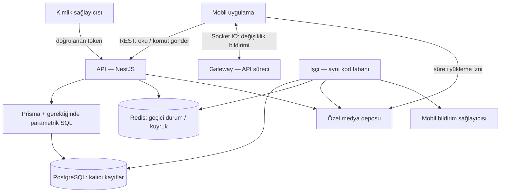

# Backend mimarisi — taslak v0.1

Tarih: 10 Ekim 2026. Bu belge ürün konuşmasına dayanır. Kullanıcının onayladığı kurallar ile tasarım önerileri aşağıda ayrılmıştır. Kapasite, ekip büyüklüğü ve mobil framework henüz belli değildir.

**Öncelik güncellemesi:** Oyun/podyum ve oyuna bağlı canlı bağlantı/eşleşme/rekabet Faz 2'dedir. Aşağıdaki oyun mimarisi sonraki faz için korunur; Faz 1'i veya frontend teslimini bekletmez. Sosyal kombin, ürün kimliği/trendler ve affiliate/reklam/Plus işleri önce gelir. Ayrıntı: [mentör notu](mentor-notes-2026-10-10.md), [güncel sıra](backend-roadmap.md#uygulama-sırası).

Faz 1 sahipliği: kullanıcı/sosyal/medya/oylama/bildirim ve ortak altyapı bizde; planlanan katalog/trend/billing/reklam modülleri arkadaşta. Ortak şema ve arayüz entegrasyonları [iki kişilik planda](two-developer-plan.md) açıklanır; yeni modüller henüz uygulanmadı.

## 1. Karar özeti

**Onaylananlar:** Normal oy kişisel tercihtir; çoğunluğu seçme ödülü yoktur. Arkadaşlara özel kombini yalnızca arkadaşlar, herkese açık kombini herkes görür. Podyum, tema açıklanıp fotoğraf hazırlanması ve oyuncuların birbirini yıldızlarla değerlendirmesiyle oynanan eşzamanlı oyundur. Kamera yayını yoktur. Yerel geliştirmede Prisma kullanılacaktır.

**Önerilen başlangıç:** TypeScript + NestJS ile modüler monolit; Prisma ORM + PostgreSQL; REST üzerinden komutlar; Socket.IO üzerinden durum değişikliği haberleri; arka plan işçisi. Redis/BullMQ, medya deposu ve kimlik sağlayıcısı ilgili aşamada eklenecektir. Bunlar bugün kurulmuş servisler değildir.

Bu depoda bugün veritabanı temeli, ortak HTTP altyapısı, Swagger, health, auth, users, social ve yerel media modülü çalışır. E-posta/şifre ve yerel opaque oturumlar, profil/stil/özel bilgiler/izin/ayarlar, arkadaşlık/engel/arama ve yerel fotoğraf/manuel blur/önizleme/avatar uygulanmıştır; e-posta yerel dosyaya teslim edilir, Google/Apple geliştirme mock'udur. Gerçek OAuth/e-posta, oylama/oyun API'leri, otomatik yüz tespiti/bulut medya/ayrı işçi, abonelik ve bildirim entegrasyonları henüz yazılmadı. [Uygulanan kararlar](implementation-decisions.md), [auth davranışı](auth-development.md), [profil davranışı](users-development.md), [sosyal davranış](social-development.md), [medya davranışı](media-development.md).

## 2. Sistemin şekli

İlk dağıtımda API ve işçi iki süreçtir; aynı sürümden çıkarlar ve tek PostgreSQL kullanırlar. Socket gateway API içinde başlar. Modüllerin ayrı deploy edilmesi gerekmez. PostgreSQL dışındaki kutular geliştirme yol haritasıdır.

Fotoğraf dosyaları veritabanına base64 olarak yazılmaz; dosya anahtarı, sahiplik, işleme durumu ve boyut gibi bilgiler yazılır.

## 3. Modüller ve sahiplik

Kod düzeni `src/common`, `src/database`, `src/modules/<özellik>`, `src/app.module.ts` ve `src/main.ts` şeklindedir. `DatabaseModule`, PrismaService'i export eder; ihtiyaç duyan özellik modülü DatabaseModule'ü import eder. PrismaService uygulama açılırken bağlanır, kapanırken bağlantıyı bırakır. CLI/seed bağımsız Prisma istemcisi kullanır.

Özellik içinde `*.module.ts`, `*.controller.ts`, `*.service.ts` ve gerektiğinde `dto/`, `guards/`, `decorators/`, `strategies/` bulunur. HTTP ayrıntıları controller'da, iş kuralları/transaction'lar service'te kalır. Her modüle gereksiz alt klasörler açılmaz. `common` yalnızca ortak teknik altyapıdır; domain servislerini toplamaz. [NestJS başlangıç yapısı](https://docs.nestjs.com/first-steps), [yaşam döngüsü](https://docs.nestjs.com/fundamentals/lifecycle-events)

| Modül | Sorumluluk | Başka modüle açtığı işlem |
| --- | --- | --- |
| auth | E-posta/şifre, token/oturum doğrulama, mock kimlik, hesap durumu; ileride gerçek OAuth | Global `AuthGuard`, `CurrentUser`, `AuthService` |
| users | Profil, stil etiketleri, özel demografik alanlar | Kamusal profil / uygunluk girdisi |
| social | Arkadaş isteği, kabul, engelleme | `areFriends`, `hasBlock` |
| media | Yükleme izni, dosya işleme, önizleme, yetkili görüntüleme | `requirePublishableAsset` |
| polls | Taslak, yayın, oy, sonuç, yorum, kaydetme ve akış | Oylama işlemleri ve akış okuma modeli |
| games | Oda, eşleşme, katılım, tema, tur, değerlendirme, sonuç | Oyun komutları / kullanıcıya özel anlık durum |
| rewards | Oyun sonucundan puan kayıtları | `applyAwardOnce` |
| notifications | Uygulama içi bildirim ve push | Olay tüketimi |
| health | Süreç/DB erişilebilirliği | Liveness/readiness endpoint'leri |
| Moderation | Şikâyet, kaldırma, yaptırım ve denetim | İçerik erişilebilirliği |
| Billing (sonra) | Abonelik, yetkiler, kullanım hakkı | `hasEntitlement`, `consumeQuota` |

Her modül kendi yazma kurallarını yönetir. Controller içinde doğrudan başka modülün tablosunu güncellemek yerine uygulama servisi çağrılır. Ortak transaction gerektiğinde uygulama servisi Prisma transaction istemcisini ilgili işlemlere geçirir. Başlangıçta aynı DB'de gerekli join'ler yapılabilir.

## 4. PostgreSQL ve Redis ayrımı

PostgreSQL'de tutulur: oylar, arkadaşlık, engeller, medya kayıtları, oda ve tur durumu, süre sonları, sonuçlar, puan hareketleri, iş olayları.

Redis'te tutulabilir: bağlantı/presence bilgisi, kısa ömürlü eşleşme adayları, rate limit sayaçları, Socket.IO adapter mesajları ve BullMQ işleri. Redis kaybı oyları, sonuçları veya oda üyeliğini kaybettirmez. Aktif oda üyeliğinin tekilliği DB'de korunur.

Cache başlangıçta zorunlu değildir. Özellikle kişiye göre görünürlüğü değişen akış ve arkadaş içeriği ortak bir cache anahtarıyla sunulmaz.

## 5. Canlı oyunda sunucu otoritesi

Oda için `status`, `version`, `phaseEndsAt`, `currentRoundIndex`, kuralların kopyası ve tüm değerlendirmeler DB'dedir. Telefon yalnızca kalan süreyi gösterir. Telefonun saati, gönderdiği puan toplamı veya kazanan bilgisi kabul edilmez.

Oda komutları ve zamanlayıcı aynı oda satırını kilitler. Başarılı geçiş `version` değerini artırır; olay aynı transaction'da outbox'a yazılır. Kuyrukta eski sürüme ait iş gelirse yeni aşamayı ilerletemez.

Her saniye DB'ye sayaç yazılmaz. Sunucu `serverNow` ve `phaseEndsAt` döndürür; uygulama görsel geri sayımı kendi yapar. Yeniden bağlanınca kullanıcıya özel güncel durum REST ile alınır. `GameEntry` veya Prisma'nın ilişki nesneleri doğrudan JSON olarak döndürülmez; tur sırasında sahibin kimliği ve dosya adları gizlenir.

## 6. Zamanlama ve çökmeden toparlanma

İş planlamak tek başına süreyi korumaz. BullMQ gecikmeli işler tam belirlenen anda çalışmayı garanti etmez. Bu nedenle komut işlenirken DB saati ve kayıtlı son süre ayrıca kontrol edilir. [BullMQ delayed jobs](https://docs.bullmq.io/guide/jobs/delayed)

Önerilen oyun işleyişi:

1. Oda işlemine `SELECT ... FOR UPDATE` ile gir.
2. Kilit alındıktan sonra `clock_timestamp()` oku; transaction başında sabitlenen `now()` ile gecikmiş komutu kabul etme.
3. Beklenen sürüm, aşama, üyelik, süre ve uygunluğu doğrula.
4. Durumu ve outbox olayını tek transaction'da yaz.
5. Commit'ten sonra işçi olayı işler.

Kilit altında kabul kontrolü yapıldığı anda süre dolmamışsa komut kabul edilmiş sayılır; commit'in birkaç milisaniye sonra tamamlanması bu kararı değiştirmez. İşçinin zamanı geçirmesi yeni oy için ek süre oluşturmaz.

İşçi başlangıçta ve düzenli aralıklarla süresi geçmiş aktif odaları/oylamaları tarar. Redis ve kuyruk sıfırlansa bile DB'den işlerini yeniden kurabilir. Uzun kesintide eski turları art arda oynatıp oy toplamaz: yapılandırılan kesinti eşiği aşılırsa oda `SYSTEM_INTERRUPTION` nedeniyle ödülsüz iptal edilir; kısa gecikmede sıradaki tur gerçek açılış anından başlayan tam süreyle açılır. Eşik başlangıç önerisi 60 saniyedir, ölçümle ayarlanacaktır.

PostgreSQL satır kilitleri transaction bitimine kadar çakışan yazmaları koordine eder. Başlangıçtaki oda başına seri işlem yaklaşımı bunun üzerine kuruludur. [PostgreSQL locks](https://www.postgresql.org/docs/current/explicit-locking.html)

## 7. Outbox ve tekrar işleme

DB değişikliği ile dış olayın ayrı ayrı yazılması şu hatayı üretir: oy kaydolur ama bildirim işi oluşmaz. `OutboxEvent` aynı transaction'a girer. İşçiler kısa transaction'da uygun kayıtları `FOR UPDATE SKIP LOCKED` ile sahiplenir, süreli lease yazar ve dış işi transaction dışında yapar.

İşçi dış işi yaptıktan hemen sonra çökerse aynı olay tekrar işlenebilir. Bu yüzden bildirim `(userId, eventId, type)`, ödül kaynak kimliği ve iş komutları bakımından tekrar uygulanmaya dayanıklı olmalıdır. Dış sağlayıcı tekilleştirme sunmuyorsa push'un tam bir kez ulaşacağı sözü verilmez. Uygulama içi kayıt tekilleştirilir. [BullMQ idempotent jobs](https://docs.bullmq.io/patterns/idempotent-jobs)

Outbox'ın `publishedAt` alanı olayın istemciye kesin ulaştığı anlamına gelmez. Redis Pub/Sub kalıcı teslim garantisi sunmaz; Socket.IO yeniden bağlanma kurtarması da her zaman başarılamaz. Canlı olaylar güncel durumu tekrar okumayı tetikler. [Redis Pub/Sub](https://redis.io/docs/latest/develop/pubsub/), [Socket.IO recovery](https://socket.io/docs/v4/connection-state-recovery/)

Birden fazla API örneğine geçildiğinde adapter kurulur. İlk tercih WebSocket-only taşıma ve REST durum yenilemesidir; polling kullanılacaksa yük dengeleyicide sticky session ihtiyacı ayrıca uygulanır. Standart Redis adapter'ın connection-state recovery desteklediği varsayılmaz. [Socket.IO Redis adapter](https://socket.io/docs/v4/redis-adapter/)

## 8. Yetki ve gizlilik

- `canViewPoll` içerik durumunu, hesap durumunu, engeli ve görünürlüğü kontrol eder. Yazar kendi görünür içeriğine erişir. `FRIENDS` için mevcut kabul edilmiş arkadaşlık gerekir.
- `canVotePoll`, görüntüleme iznine ek olarak kendi paylaşımı olmama, açık süre, tek oy ve varsa kitle koşullarını kontrol eder.
- Görünürlük/kitle ayrıdır: `PUBLIC + WOMEN` herkese görünür, yalnızca uygun kişiler oy verir. Bu birleşim öneridir; kullanıcı henüz kitle kurallarını kesinleştirmedi. İlk API sürümü yalnızca `ANY` kabul eder.
- Liste, detay, arama, kaydedilenler, yorumlar, sonuçlar ve medya aynı görünürlük kuralını uygular. UI'da kartı gizlemek yeterli değildir.
- Arkadaşlık kalkınca arkadaş oylaması ve görselleri için yeni erişim durur. Eski oy toplamda kalır. Engelleme iki yöndeki etkileşimi kapatır.
- İlk sürümde tüm medyalar özel depoda tutulur. Görüntüleme, her istekte yetki kontrol eden `/media/:id/content` üzerinden yapılır. Arkadaş görselleri için uzun ömürlü imzalı indirme linki verilmez; yanıtlar ortak cache'e girmez. Önceden indirilmiş görüntüyü cihazdan geri alma garantisi verilemez.
- Push'ta özel soru, fotoğraf veya yorum metni taşınmaz; uygulama açıldığında yetkili kaynak okunur.
- Demografik alanlar kamusal profil DTO'suna girmez; küçük grupların kırılımları gösterilmez. İstatistik yayını geliştirme aşamasına kadar kapalıdır.

## 9. Fotoğraf hattı

`upload intent → özel staging alanına yükleme → complete → doğrulama/işleme → önizleme kabulü → yayınlanabilir medya`.

Yerel uygulama: 15 dakikalık tek kullanımlık izin + Bearer ile multipart yükleme, özel dosya deposu, Sharp ile senkron işleme, EXIF'siz WebP/thumbnail, manuel blur bölgeleri ve açık önizleme onayı. Otomatik yüz tespiti henüz bağlı değildir. Ayrı işçi/bulut sağlayıcı ve zamanlanmış temizlik gerçek entegrasyon işidir. [Çalışan sözleşme](media-development.md).

İmzalı yükleme URL'si tek kullanımlık varsayılmaz; süre içinde tekrar kullanılıp aynı anahtarın içeriği değiştirilebilir. Bu yüzden işlenecek kaynak sürümü/checksum sabitlenir ve gösterilecek dosya istemcinin yazamadığı ayrı, değişmez bir anahtara üretilir. [S3 presigned URLs](https://docs.aws.amazon.com/AmazonS3/latest/userguide/using-presigned-url.html)

Dosya türü gerçek içerikten kontrol edilir; boyut/piksel sınırı uygulanır; EXIF temizlenir. Yüz bulanıklaştırma istenmişse başarılı işleme ve kullanıcı önizleme onayı olmadan normal oylama yayınlanmaz. Otomatik yüz tespiti tüm yüzleri bulma garantisi değildir; tespit başarısızsa kullanıcıya yeniden düzenleme/iptal seçeneği gerekir. Orijinal dosyaya kamusal erişim endpoint'i açılmaz.

## 10. Akış, sayaçlar ve ölçekleme

Başlangıç akışı: açık, erişilebilir, kullanıcının kendi paylaşımı olmayan, oy vermediği oylamalar; kategoriye göre filtre; `(publishedAt, id)` ile cursor sayfalama. Arkadaşlar akışı kabul edilmiş arkadaşlarla sınırlandırılır. Keşif sıralaması sonradan ayrı okuma modeline dönüşebilir.

Başlangıçta sonuçlar indeksli `PollVote` kayıtlarından `GROUP BY` ile hesaplanır. Kalıcı oy kayıtları asıldır; Redis sayacı sonuç değildir. Ölçülen sorgu yükü büyürse transaction'da güncellenen sayım tablosu veya yeniden üretilebilir özet eklenir. Bütün oyları JSON dizisi olarak oylama satırına doldurmayız.

İlk sürümde mikroservis, Kafka, Elasticsearch, ayrı grafik DB veya Kubernetes gerekmiyor. Medya işçisi CPU yükü, gateway bağlantı sayısı veya akış sorgu maliyeti ölçülerek ihtiyaç olan parça bağımsız ölçeklenir. Kullanıcı sayısından ölçülmemiş kapasite sonucu çıkarılmadı.

## 11. Teknoloji gerekçesi

Prisma kullanıcının tercihidir. PostgreSQL, ilişkiler ve tekillik kısıtlarıyla oy/üyelik bütünlüğünü destekler. NestJS önerisi; kimlik, sosyal, oylama ve oyun sınırlarını modüllerde tutabilmesi ve gateway entegrasyonuna dayanır. Framework ekip tercihiyle değişebilir; alan kuralları korunur. [NestJS modules](https://docs.nestjs.com/modules), [NestJS gateways](https://docs.nestjs.com/websockets/gateways)

Prisma CLI/Client/adapter `7.10.0` sürümüne birlikte sabitlendi. İncelenen resmi dokümanda 8 sürümü RC olarak geçiyor; yerel altyapı için desteklenen 7 hattı kullanıldı. [Prisma release status](https://www.prisma.io/docs/orm/release-status)

## 12. Yerel ortamın sınırı

Bu makinede PostgreSQL ve Docker bulunmadığından `prisma dev` kullanılır. Bu seçenek yerelde PGlite üzerinde çalışır ve aynı anda tek DB bağlantısını destekler. Şema, migration, seed ve ilişkisel bütünlük kontrolüne uygundur; çok bağlantılı kilit, yüksek eşzamanlılık ve üretim kapasitesi kanıtı değildir. [Local Prisma Postgres](https://www.prisma.io/docs/local-development/postgres)

Gerçek PostgreSQL için alternatif `compose.yaml` vardır. Oyun motorunu güvenilir saymadan önce gerçek PostgreSQL üzerinde yarış koşulu ve yeniden başlatma testleri yapılacaktır.
